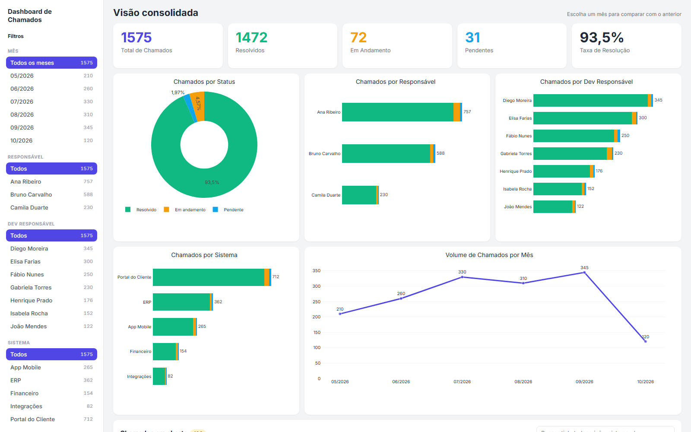
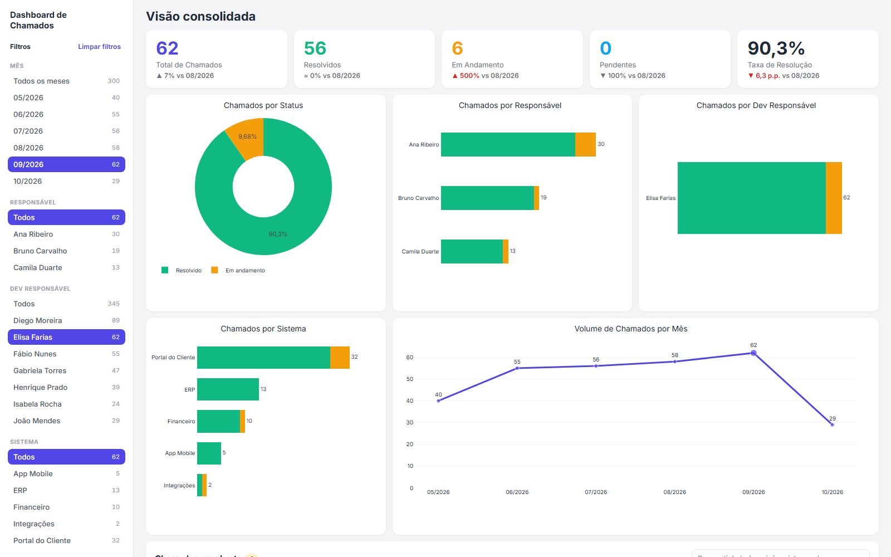
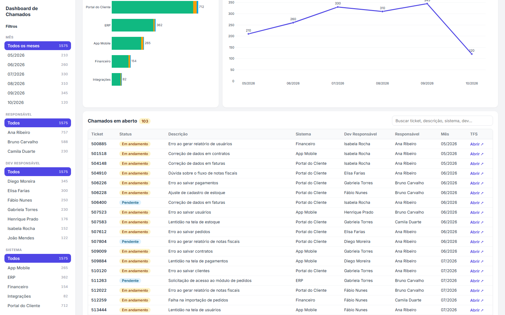

# Dashboard de Chamados

Pipeline em Python que consolida uma planilha de chamados de suporte (Google
Sheets, uma aba por mês) e publica um dashboard interativo, atualizado
automaticamente sempre que a planilha muda.

> As imagens abaixo usam **dados 100% fictícios**, gerados por
> [`demo/gerar_demo.py`](demo/gerar_demo.py). Nenhum dado real é versionado
> neste repositório.



## Funcionalidades

- **Consolidação automática:** junta todas as abas `Chamados - MM/AAAA` numa
  só, descarta linhas vazias e resolve Ticket IDs duplicados (vale o mês mais
  recente). Um mês novo é só criar a aba, sem mexer no código.
- **Atualização quando a planilha muda:** roda a cada 10 minutos em horário
  comercial, mas só processa algo se a planilha foi alterada. A checagem
  consulta apenas a data de modificação, sem ler os dados.
- **Dashboard interativo** (HTML único, gráficos com Plotly.js):
  - filtros por mês, responsável, dev, sistema e status, com a contagem de
    cada opção e salvos no link;
  - cartões com comparação com o mês anterior;
  - barras divididas por status (resolvido, em andamento, pendente);
  - tabela de chamados em aberto com busca e link para o ticket.
- **Publicação:** Google Drive (pasta restrita) e PythonAnywhere (link fixo
  com login).

| Filtrando por mês e dev | Chamados em aberto |
|---|---|
|  |  |

## Como funciona

```
Google Sheets            python main.py (Agendador do Windows)          Publicação
─────────────            ─────────────────────────────────────          ──────────
Chamados - 08/2026 ─┐    0. está no horário? a planilha mudou?
Chamados - 09/2026 ─┼──► 1. lê as abas mensais
Chamados - 10/2026 ─┘    2. consolida e remove duplicados
                         3. escreve na aba "Consolidado" ────────────► Google Sheets
                         4. gera o dashboard.html
                         5. envia para o Google Drive ───────────────► pasta restrita
                         6. envia para o PythonAnywhere ─────────────► link com login
```

**Stack:** Python, pandas, gspread, Google Sheets/Drive API, Plotly.js,
Flask (portal com login), Agendador de Tarefas do Windows.

## Executar

```bash
pip install -r requirements.txt
cp .env.example .env          # e preencha os valores
python main.py --forcar       # roda agora, sem checar horário/alterações
```

O passo a passo completo (conta de serviço do Google, Drive, PythonAnywhere,
agendamento e solução de problemas) está em
[`docs/GUIA_PIPELINE.md`](docs/GUIA_PIPELINE.md).

### Ver a demonstração

Não precisa de credenciais:

```bash
python demo/gerar_demo.py
```

Gera `demo/dashboard_demo.html` (abra no navegador) e os prints em `docs/img/`.

## Estrutura

```
.
├── main.py                     # ponto de entrada (checagens + pipeline)
├── config.py                   # configurações gerais (segredos vêm do .env)
├── .env.example                # modelo do .env, sem valores reais
├── src/
│   ├── sheets.py               # lê e consolida a planilha
│   ├── dashboard.py            # gera o dashboard.html
│   ├── drive.py                # Google Drive (upload e data de modificação)
│   └── hospedagem.py           # publica no PythonAnywhere
├── portal_flask_app.py         # portal com login (roda no PythonAnywhere)
├── rodar_diario.bat            # chamado pelo Agendador de Tarefas
├── configurar_agendamento.ps1  # configura o Agendador (seg-sex, 9h-17h)
├── demo/gerar_demo.py          # dados fictícios + prints do README
└── docs/GUIA_PIPELINE.md       # guia completo
```

## Segurança

- **Sem segredos no código:** tokens, senhas e IDs ficam no `.env`. O `.env`,
  o `credentials.json`, o `dashboard.html` (dados reais) e os logs estão no
  `.gitignore`.
- **Dados mínimos no HTML:** descrições e links só entram para chamados em
  aberto.
- **Página blindada:** Content-Security-Policy impede a página de enviar dados
  para qualquer servidor, e o Plotly.js é carregado com verificação de
  integridade (SRI).
- **Portal com login:** redireciona HTTP para HTTPS antes de pedir a senha,
  bloqueia temporariamente após várias senhas erradas e envia cabeçalhos de
  segurança (HSTS, sem cache, sem iframe).
